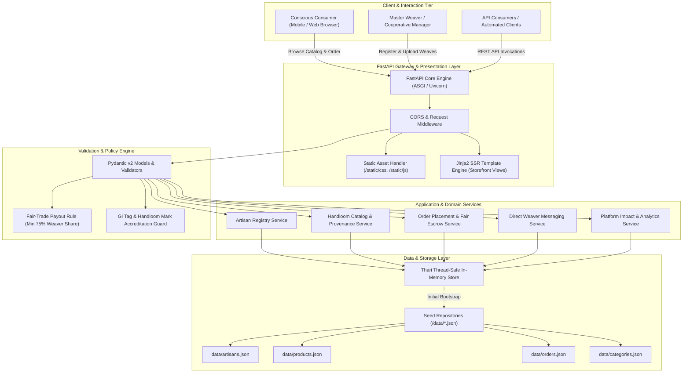
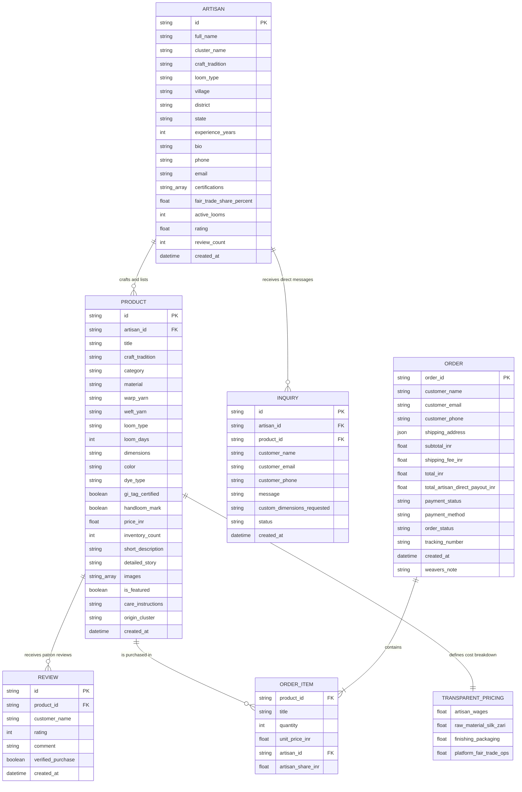
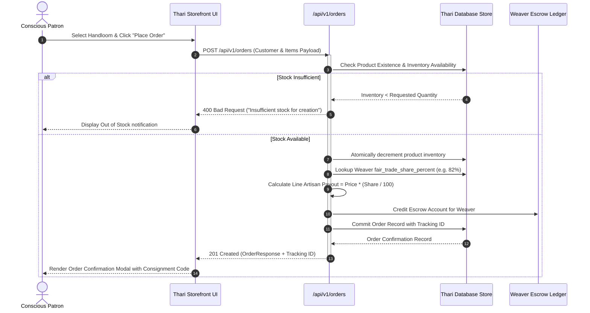
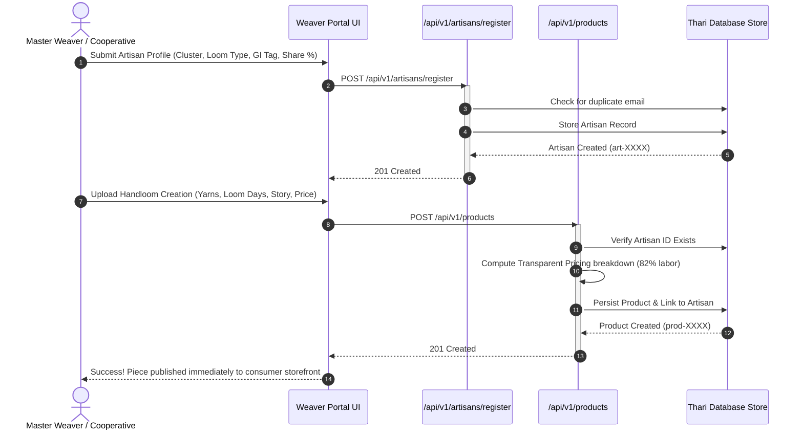
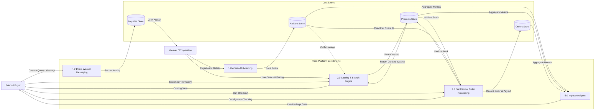

# 📐 Thari - Technical Design Document

**Project:** Thari Handloom D2C Platform  
**Architecture Version:** 1.0.0  
**Status:** Approved & Implemented  
**Date:** October 2026  

---

## 1. Executive Summary & Design Philosophy

**Thari** is an ethical, Direct-to-Consumer (D2C) marketplace platform engineered to bridge Indian traditional handloom weavers directly with conscious consumers. The platform solves the chronic exploitation of weavers in conventional retail supply chains—where intermediaries pocket up to 70% of retail margins—by guaranteeing that **75% to 85% of retail price is remitted directly into the artisan's hands**.

### Core Architectural Principles:
1. **Radical Transparency:** Every product record contains structured mathematical cost breakdowns (artisan labor wages, raw materials, finishing, and escrow ops).
2. **Provenance-First Data Model:** Products are intrinsically tied to certified artisans, geographic coordinates/clusters, loom mechanisms, and Geographical Indication (GI) tag verifications.
3. **High Performance & Asynchronous Operations:** Built atop FastAPI and Python 3.11 for non-blocking I/O, strict Pydantic validation, and low latency.
4. **Zero-Dependency Native Frontend:** Responsive, accessible handloom-themed UI rendered via Jinja2 SSR and vanilla ES6 client logic without complex Node/bundler overhead.

---

## 2. High-Level System Architecture

The following diagram illustrates the multi-tier system topology of Thari:

---

## 3. Entity-Relationship Model (Data Architecture)

The data model connects artisans with their handloom creations, customer reviews, direct inquiries, and customer orders with itemized fair-trade shares:

---

## 4. Sequence Diagrams

### 4.1. Customer Storefront Order Placement & Fair Escrow Settlement

### 4.2. Artisan Onboarding & Handloom Product Upload Workflow

---

## 5. Data Flow Diagram (DFD - Level 1)

---

## 6. Technology Stack Justification

| Layer | Chosen Technology | Rationale & Trade-offs |
| :--- | :--- | :--- |
| **Backend Framework** | **FastAPI (Python 3.11)** | Provides native asynchronous endpoints, automatic OpenAPI documentation, automatic validation via Pydantic, and exceptional execution speed comparable to NodeJS and Go. |
| **Validation Layer** | **Pydantic v2** | High-performance C-based `pydantic-core` parsing, strict schema enforcement, and declarative data typing. |
| **Server Engine** | **Uvicorn (ASGI)** | High-throughput asynchronous server supporting HTTP/1.1 and WebSockets. |
| **Template Engine** | **Jinja2** | Server-Side Rendering (SSR) gives instantaneous first-contentful paint without requiring heavy frontend JavaScript bundle downloads. |
| **Presentation Tier** | **Pure Modern CSS & Vanilla ES6** | Handloom-themed design system (Terracotta, Indigo, Raw Silk, Gold Zari) built with CSS custom properties and CSS Grid. Zero NPM or bundler dependencies required. |
| **Data Layer** | **Hybrid In-Memory + Seed JSON** | Zero-latency reads and writes with bootstrap seeding from `data/*.json`, enabling immediate evaluation and testing without complex database server setup. |
| **Test Suite** | **Pytest + HTTPX** | Deterministic unit and integration tests with automatic state isolation via fixtures. |

---

## 7. Security, Resilience & Quality Attributes

1. **Input Sanitization & Schema Validation:**
   - All inbound data payloads are strictly validated by Pydantic models with minimum/maximum length constraints, numerical bounds (e.g. `experience_years <= 80`, `loom_days <= 180`, `price_inr > 0`), and regex-based email validation.
2. **Fair-Trade Share Enforcement:**
   - Platform rules reject fair-trade artisan cuts below 70%, with a system default of 82% direct remittance.
3. **Inventory Race Condition Mitigation:**
   - In-memory order processing checks inventory and decrements atomically before order commitment.
4. **Offline Resilience:**
   - Email validation and core business logic run without external DNS queries or third-party web requests, ensuring dependable operation in sandboxed or air-gapped environments.

---

## 8. Extensibility & Future Scalability Roadmap

1. **Database Persistence Migration:**
   - Pluggable interface to transition `ThariDatabase` to **PostgreSQL** with SQLAlchemy 2.0 ORM and Alembic migrations.
2. **Automated Split Payments (UPI & Razorpay Route):**
   - Direct split disbursement at gateway level: 82% routed to Weaver's bank account, 5% to platform operations, and remainder to logistics.
3. **Weaver Voice & Multilingual Interface:**
   - Mobile PWA with voice recognition in regional languages (Hindi, Tamil, Telugu, Odia, Bengali) enabling non-literate weavers to dictate loom progress.
4. **Blockchain Provenance & NFC Weave Tags:**
   - Verification tags embedded into sari selvages linking to immutable on-chain proof of artisan identity, loom location, and GI authenticity.
